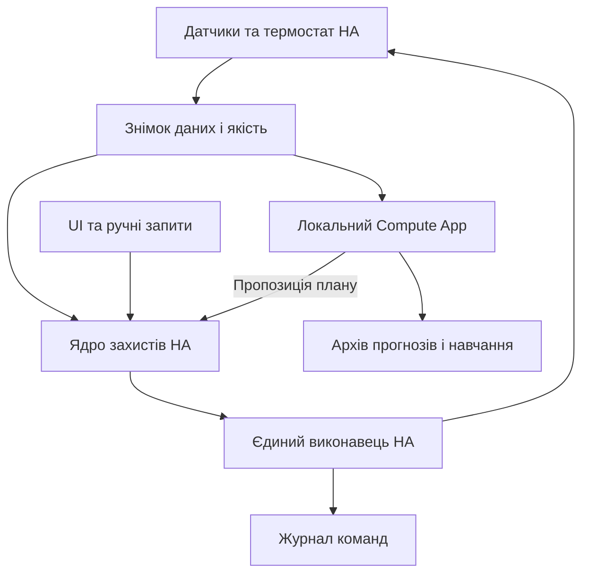

# Heating AI 2.0 — архітектурний проєкт

**Статус:** пропозиція для погодження, реалізацію не розпочато. Підстава — U0, A01–A14 з документа 01. Повний приймальний контракт — requirements.csv; усі наведені нижче значення є проєктними цілями, якщо прямо не названі чинними налаштуваннями.

## Рішення і межі автономності

Два компоненти: **Heating Control integration** усередині HA Core та **Heating Compute App** на локальному сервері. Перший містить чисте safety kernel, короткий reducer стану, адаптери поточних вимірів і єдиний command gateway. Другий — окремі обмежені обчислювальні workers планування/навчання та сховище історії. UI входить у HA, використовує автентифіковані API; його закриття не впливає на керування.

Немає залежності від Інтернету, AI, AppDaemon або відкритого браузера для короткого керування й резерву. Після втрати compute застосовується обмежений чинний план, потім детермінований fallback. За втрати HA Core чи каналу до термостата нові команди фізично неможливі. OEM-захисти котла лишаються обов'язковими; це програмна ізоляція планувальника, а не окремий сертифікований апаратний контролер безпеки.

## Карта модулів і напрям залежностей

| ID | Відповідальність | Може командувати? | Залежності |
|---|---|---|---|
| contracts | Immutable типи, units, versions, errors | Ні | — |
| data-quality | Перевірка віку/правдоподібності/джерела, power topology | Ні | contracts |
| safety-kernel | Чиста функція дозволу/заборони; не робить I/O | Ні | contracts |
| control-runtime | Один reducer подій, valid plan, ownership, fallback | Через gateway | contracts, data-quality, safety-kernel |
| command-gateway | Єдина програмна точка thermostat/fan service calls | Так | contracts, safety-kernel, control-store |
| control-store | Транзакційні critical settings/ownership/one-shot/outbox | Ні | contracts |
| thermal-model | Observer, prediction, calibrated power, disturbances | Ні | contracts |
| planner | Bounded deterministic scheduling й обґрунтування | Ні | thermal-model, contracts |
| learning | Fit candidate і holdout, повертає лише кандидат | Ні | thermal-model, contracts |
| evidence-store | Прогнози, енергія, телеметрія, порівняння, retention | Ні | contracts |
| ha-adapter | Event subscription, services для intent, compact sensors/API | Тільки через gateway | control-runtime |
| ui | Presentation/explicit user intent | Ні | versioned public API |

Логічні зворотні зв'язки передаються подіями контрактів, а не циклічними imports. Планувальник не імпортує HA API, gateway або mutable runtime. Навчання не змінює champion у спільній пам'яті. Читання історії не отримує mutex, який потрібний зупинці нагріву.

## Варіанти та ADR

| ADR | Прийнята пропозиція | Альтернатива і причина відмови | Наслідок |
|---|---|---|---|
| 01 | HA control + compute App | Залишити все AppDaemon — спільні lifecycle/GIL/черги; перенести все в HA — CPU ризик для Core | Два артефакти, потрібна сумісність protocol |
| 02 | Один HA gateway, fallback у ньому | Два активні thermostat writers із heartbeat lease не забезпечують fencing у звичайному термостаті | Watchdog стає intent, старі writers зупиняються при cutover |
| 03 | Детермінований planner без AI | LLM в control path не має bounded latency і відтворюваності | AI advice опційний, можна вимкнути повністю |
| 04 | SQLite для critical state та evidence, окремі БД | Один великий JSON має coarse rewrite й слабку cross-record atomicity; PostgreSQL зайвий для одного будинку | Локальний диск, schema migration, backup API й budget |
| 05 | Чинна двостанна модель як baseline | Нова neural model вимагає нової доказової бази й може втратити накопичені знання | Нові моделі проходять challenger process |
| 06 | Read-only вентиляційні features | Перебудова вентиляційної автоматики виходить за scope | Немає керування рекуператором/витяжками без окремої майбутньої вимоги |
| 07 | Snapshot + event/outbox, без distributed event bus | Kafka/Redis/Docker orchestration додають нові точки відмови | Один локальний захищений transport, bounded inbox |

SQLite WAL дозволяє concurrent reads, але має обмеження одного host і вимоги до синхронізації. Для critical DB: `journal_mode=WAL`, `synchronous=FULL`, перевірений локальний filesystem; не NFS. Проєкт перевіряє фактичний режим після відкриття. [WAL](https://www.sqlite.org/wal.html), [synchronous](https://sqlite.org/pragma.html#pragma_synchronous). Hardware/storage, що ігнорує flush, не перетворюється на надійне лише від PRAGMA.

Перед увімкненням WAL перевірити **фактичну linked SQLite**, а не лише Python/package version: ≥3.51.3 або документований patched backport 3.44.6/3.50.7 для WAL-reset race. Заборонений невідомий неперевірений backport. Це вимога до нового компонента, не доручення оновлювати production HA. [Офіційний опис WAL-reset](https://www.sqlite.org/wal.html#walreset). При несумісному runtime G3 заблокований до погодженого пакування сумісної бібліотеки/еквівалентного перевіреного storage рішення.

HA забороняє blocking disk/network у своєму event loop: I/O переноситься в dedicated executor. [Офіційні правила](https://developers.home-assistant.io/docs/asyncio_blocking_operations/). Для старого runtime AppDaemon executor уже є корисним патерном, але не заміною процесній ізоляції. [AppDaemon guide](https://appdaemon.readthedocs.io/en/latest/APPGUIDE.html).

## Контракти даних

Внутрішні timestamps — UTC epoch із явно задокументованою точністю; local policy — ZoneInfo Europe/Kyiv (поточний alias Europe/Kiev приймається). Duration/deadline всередині process — monotonic. Після reboot monotonic не відновлюється з диска; тривалість заново оцінюється консервативно за UTC та фактом стану.

| Тип | Обов'язкові поля | Інваріанти |
|---|---|---|
| Reading | source_id, physical_id, value nullable, unit, observed_at, received_at, source_sequence optional, quality, evidence_ids | value=None не 0; час публікації adapter не освіжає observed_at |
| Quality | status=valid/estimated/stale/missing/conflicting, reason, age_s, bounds optional | Баланс за виміряними компонентами має kind=derived, independent=false |
| ControlSnapshot | snapshot_id/hash, captured_at, config_rev, model_rev, topology_rev, grid_epoch, readings, permits, ownership | Недостатньо «один HA запит»: перевіряється skew джерел |
| Plan | plan_id, issued_at, valid_from/until, input_hash, revisions, segments, curves, feasibility, coverage, reason_codes, energy_scopes | Half-open segments [start,end), sorted/nonoverlap, finite numbers; immutable |
| CommandIntent | intent_id, boot_id, owner_epoch, sequence, action, not_before, expires_at, snapshot_id, plan_id optional, reason | Не містить довільного domain/service від compute |
| CommandReceipt | intent_id, prepared_at, sent_at, ha_ack_at, device_echo_at, physical_effect_at, status/error | Кожен рівень має свою доказовість; «успіх» service не фізичний ON |
| EnergyInterval | interval_id, [start,end), method, kwh nullable, lower/upper, coverage, source_ids, quality, origin | Рівно один канонічний внесок; correction окремою подією |
| ForecastEvidence | snapshot_id, plan_id, issued_at, reference_at/type, actual_lead_h, curve_hash, original_data | Стару криву не обчислювати заново сучасною моделлю |
| ModelCandidate | candidate_id, parent_rev, dataset_hash, train/holdout windows, metrics_by_horizon/regime, limits | Промоція тільки на чинного parent; atomic receipt |

Усі зовнішні JSON перевіряються schema і finite/units/range/size до запису. Unknown enum, несумісна major schema або надмірний payload не змінює чинного стану. Температури °C, потужність W на I/O/кВт у моделі лише через явний converter, енергія кВт·год, trend °C/год. Decimal/достатня float precision для накопичення з допуском 10⁻⁶ кВт·год у migration checks; жодних локалізованих ком як числового transport.

## Керування та пріоритети

Порядок рішень: апаратна межа/невідомий небезпечний стан → явне вимкнення/ручне володіння → дозвіл команд → фізична доступність мережі/термостата → safety upper/return → дозволені стратегією вікна → мінімальні switching times → поточний валідний план/резерв → бюджет/тариф. Min-on не затримує safety OFF. Апаратне антизамерзання й насос не відключаються помилково як «зайве тепло».

`upper` — керована комфортна межа, не обіцянка миттєвого охолодження інерційної підлоги. При досягненні межі подача тепла припиняється; прогнозний coast з запасом має зупиняти раніше. Якщо камін продовжує нагрів, UI пояснює залишковий ризик, а не обіцяє недосяжний інваріант T≤upper завжди.

| Стан runtime | Умови / дія | Вихід |
|---|---|---|
| STARTING | Відновити critical DB, bindings, свіжі джерела, actual thermostat | READY або SAFE_HOLD; не програвати стару heat-команду |
| SHADOW | Читає й порівнює, hard-disabled gateway | Лише явний cutover |
| AUTO_PLAN | Є актуальний валідний план і всі guards | Intent виконання поточного segment |
| AUTO_HOLD | Compute pending, чинний план ще придатний | Утримання тільки до valid_until/найближчої межі з repeated safety checks |
| FALLBACK | Compute unavailable/plan expired, придатні базові дані | Консервативний локальний hysteresis або дозволений native-auto через той самий gateway |
| MANUAL_PAUSE | Актуальна стороння зміна термостата/вибір власника | Не відбирати керування; safety notification за небезпеки |
| OFF | Явний OFF, скасування controller demand | Зберегти OEM anti-freeze/pump contract |
| SAFE_HOLD | Немає довірених даних/стану/виконавця | Новий HEAT заборонено; safe stop коли доступний; сповіщення |

Повернення з FALLBACK: стабільні required inputs 60 с, свіжий plan із новими revision/epoch, reconcile actual state, один перехід AUTO. Базові 60 с — стартове проєктне значення; commissioning може його обґрунтовано змінити через versioned settings. Старі incident/failure deadlines не обнуляються при кожному tick. Ручний pause не скидається автоматичним recovery.

## Єдиний виконавець і fencing

Gateway існує в одному config entry HA. Дублікат binding того самого thermostat/fan відхиляється. Compute/UI/нічна automation/watchdog надсилають intents, не `climate.set_*`. Нормальна черга latest-wins обмежена одним pending desired state на пристрій, safety stop має окрему пріоритетну доріжку. Для HEAT: durable prepare з epoch/sequence → повторна перевірка live guards → bounded service call → device echo → physical observation. Якщо prepare не завершився за 250 мс, HEAT не надсилається. OFF не чекає завершення disk write або звичайної черги; спершу зупиняє demand, audit дописується після.

Немає реальної exactly-once доставки через HA до звичайного термостата. Використовуються idempotent desired-state commands і reconcile. Після crash між send/receipt новий boot звіряє actual state; невизначений результат не повторюється сліпо. One-shot має durable consumed marker до HEAT і окремий unknown_outcome; повтор лише за явним новим intent власника.

Старі event callbacks відкидаються за timestamp/epoch/context correlation тільки якщо актуальний actual state узгоджений із новішою власною командою. Поточна реальна стороння зміна має пріоритет, навіть якщо збігається за часом із service call. Подія без надійного causation не називається достовірно ручною — reconcile й пауза при невирішеному конфлікті.

Manual direct changes з UI HA та фізичної панелі можливі й розпізнаються як зовнішній owner. Gateway забезпечує одного автоматичного автора серед компонентів, що під нашим контролем; він не може технічно заборонити довільному іншому HA admin викликати service напряму. Commissioning audit інших авторів — обов'язкова умова, а не недоведена гарантія fencing на обладнанні.

## Планувальник та обмеження часу

Знімок inputs копіюється й хешується. Одна CPU worker process для planner; learner має нижчий пріоритет і не запускається одночасно з терміновим планом. Жодного необмеженого ThreadPool для CPU задач. Запит новішої revision скасовує старий або позначає результат непридатним. Soft deadline 2 с для базового плану, hard deadline 10 с для покращень. При hard deadline process завершується/перезапускається supervisor compute, повертається найкращий уже перевірений кандидат або `search_incomplete`; попередній чинний план не подовжується без перевірки.

Лексикографічна ціль: hard safety/physical constraints → мінімум deficit degree-hours у межах дозволеної стратегії → ранковий запас до наступного можливого тепла → мінімум overrun immutable cycle reference → вартість → зайві перемикання/відхилення від прийнятих session times. Зміни прогнозу не пересувають щоразу ранкові сеанси на кілька хвилин без потреби. Втрата живлення/upper/зміна стратегії відкидає stability негайно.

Невідоме майбутнє живлення можна використовувати тільки як conditional scenario. Execution все одно вимагає фактичного дозволу. `search_incomplete`, `no_feasible_plan_found` й `physically_infeasible_under_verified_bounds` — різні результати; beam search не доводить фізичну неможливість.

## Збереження і відновлення

Critical DB належить control integration: settings revisions, ownership/manual pause, one-shot markers, command outbox/receipts, active plan header. Один dedicated writer thread, bounded transaction, failure/timeout не блокують event-loop. Evidence DB належить compute: immutable plans, telemetry, energy ledger, comparison/checkpoints, model candidates. Немає залежності safety від evidence DB або history API.

Прийняття нового HEAT plan: checksum/schema → compute snapshot revisions → lightweight current feasibility/safety replay → durable control-store commit → publish plan receipt → виконання. Архів оригінального plan має бути durable перед статусом «зафіксовано прогноз»; якщо analytics недоступна, керування може продовжуватися, але evidence status=missing і жодної вигаданої ретроспективи. Транзакцій між двома БД немає: outbox sequence та idempotent import узгоджують повтори.

Після restart: critical DB integrity/версія → права й manual state → actual HA state → fresh input snapshot → bounds → новий epoch. Старі timer handles не відновлюються буквально. Команди не виконуються до READY; затверджений ownership не означає право повторити старий heat. Counter checkpoints зберігають origin і ledger seq. Невідомий downtime не заповнюється номінальними ватами.

Retention: critical receipts ≥30 днів, незмінні forecast/comparison й агрегати ≥90 днів, raw telemetry ≥30 днів, існуючий архів імпортується без втрати. Локальний budget evidence 2 ГіБ як початкова пропозиція, free reserve max(2 ГіБ, 10% filesystem). Перед погодженим rollout перевірити фактичний обсяг: при непридатному budget залишити legacy archive read-only і збільшити квоту обґрунтовано, не видаляти його заради виконання числа. Storage pressure спочатку знижує verbose logs, далі зупиняє нову аналітику/навчання; command safety не має чекати compaction. Backup — SQLite backup API/snapshot із checksums, не копіювання одного live .db без WAL.

## Показники й fault containment

| Межа | Проєктний SLO | Як вимірювати |
|---|---|---|
| Чистий safety kernel | p99 ≤10 мс на N100 | Benchmark 100 тис snapshots, окремо від мережі |
| Обробка safety event → stop intent | p99 ≤250 мс, max 1 с під контрольованим load | monotonic timestamps; диск/планер навмисно завислі |
| stop intent → service dispatch | ≤1 с за responsive HA | Не включає фізичне реле; deadline/timeout окремо |
| Контрольний цикл | 1 с, schedule lag p99≤250 мс | Observe loop lag, skip/coalesce backlog |
| План | feasible baseline ≤2 с; improvements ≤10 с | Real/edge cases + peak CPU load |
| UI command feedback | локальне «надсилається» ≤100 мс; bounded pending ≤10 с | Receipt окремо від actual effect |
| Історія | 7 днів cold p95≤2 с server, first paint≤3 с LAN | 30 днів indexed, cache/offline/errors; не MCP latency |

Немає «здоровий» лише за heartbeat. Публікуються control loop lag, latest valid input, state persistence, command outcome, actual power quality, last completed planner job, dropped results, queue depths, coverage та model validation by horizon. Сповіщення — за змінами стану з incident_id й dedup, не кожен tick. Заборонено експортувати secrets, full config, state.json або приватні telemetry у public diagnostics/GitHub.
