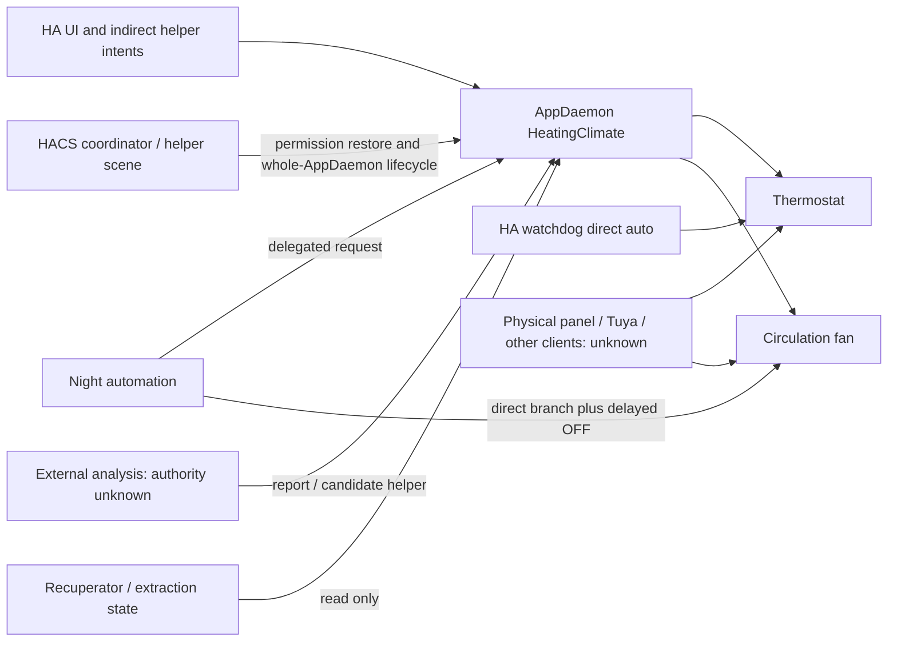

# WP0 — command owners and safety boundaries

Scope: pinned legacy 0.3.20 plus targeted current HA configuration reads H01–H08 in [00-source-and-integrity.md](00-source-and-integrity.md). **No writer was disabled, tested, replaced or activated.** External authors remain BLOCKED B04/B07; absence from a literal search is not proof of sole ownership.

## Current author inventory

| Author / route | Actual command capability and evidence | Current guard / risk | Future disposition, only after approval |
|---|---|---|---|
| AppDaemon `HeatingClimate` → `HeatingRecovery.apply_action` | `climate/set_temperature`, `climate/set_hvac_mode`, recovery.py:1148–1289. Heat, waiting/release and native fallback use the same function; verification can re-enter fallback. | allow_actuation, mode/armed, grid, upper, schedule, min-on/off, thermostat validity and absolute segments. No device-enforced owner epoch. Exact live app binding still needs YAML B01. | Move authority to one HA command-gateway; compute only proposes typed plans. |
| AppDaemon `fan_tick` → nested `send` | `fan/turn_on` with percentage, `fan/turn_off`, climate.py:1744–1810. | allow_actuation + fan_control; **does not use boiler armed as its permission**. Requires grid or declared backup plus qualified inverter; no real airflow proof. Night/fire/manual requests combined internally. | Single HA fan arbiter/gateway; preserve distinct boiler/fan permissions. |
| HA watchdog, config ID `heating_watchdog_v1` | Live H02 `climate.set_temperature` then `climate.set_hvac_mode(auto)`. | alive off ≥2min, mode Auto, armed/permitted, grid+connection on; repeated conditions and heartbeat older than180s. Computes lower waiting target outside strict hours, at upper, missing/stale room or scheduled outage. Independent second writer; sensor echoes are not relay evidence. | Fallback inside HA integration; old watchdog becomes an intent/notification route and loses direct device writes at approved cutover. |
| HA night circulation automation | H02 hourly local23–06; if fan_control/permitted then `heating_fan_night_request`; otherwise direct `fan.turn_on(38%)`, wait15min, conditionally `fan.turn_off`. | Delegation and a separate direct timer coexist. An already-running 15min branch can outlive permission changes; quiescence must include delayed actions. | Intent-only night request to arbiter; end of night must not cancel active fireplace demand. |
| HACS heating update coordinator, config ID `heating_ai_hacs_update_coordinator` | H02 changes armed/fan helpers, stops/starts **whole AppDaemon**, restores a helper scene after hashes/heartbeat/policy checks. No direct thermostat/fan service. | Indirect authority/lifecycle writer affects other apps. Restoring captured on flags is not a durable manual-ownership epoch; a user's later off intent must not be overwritten by recovery. Stored journal and in-flight phase matter. | Independent heating component lifecycle. No AppDaemon restart in new compute update; reconcile explicit newer manual authority. |
| `scene.heating_ai_before_update` | Coordinator creates/applies a scene for permission helpers. | An indirect permission restore, not independent evidence of a device command. | Include in transfer journal/consumer inventory; never assume helper restoration is physical verification. |
| Legacy embedded UI | frontend/heating-panel.js:920–945 calls only allowed input_number/input_select/input_datetime/input_boolean/input_button services. Other handlers send settings/history events through HA WebSocket. | Indirect control, settings, rollback/one-shot/proposal triggers. No literal direct climate/fan call in the reviewed frontend. HA session authorization does not replace the new backend read/control/admin checks. | Authenticated typed intents/CAS settings; no arbitrary service supplied by UI/compute. |
| AI/report/scheduled analysis clients | `proposal_changed`, `publish_ai_summary`, report helper and candidate gate in climate.py:668–686,1925–1937. | Candidate schema/bounds validation exists; actual external schedule, prompt, account and permissions not accessible. Do not assume read-only just because the output is called a report. | Preserve summary/quality compatibility; proposals remain untrusted candidates, no safety/config bypass. B07. |
| Other HA clients, Assist/admin, scripts, scenes, other AppDaemon apps or Node-RED | Direct services or generic/dynamic targets can exist outside the observed literal configs. | H03 searched exact entities and broad `climate.`/`fan.`: no other matching stored automation/script/scene writer returned. Does not scan all external app code or prove dynamic targets absent. | Read-only owner inventory and scoped future service timeline required. B04. |
| Tuya/Smart Life cloud routines, OEM programs and physical panel | Can change actual device state independently of this application. | No current external schedule export or physical inspection. Registry platform Tuya Local/Cloud does not prove absence of vendor writers or an independent relay feedback path. | Treat as external ownership; inspect with owner. Never remove timers during WP0. B04/B05. |
| Native meter/template helpers | State/counter publishers and one read-only fan template were found. | Read-only consumers are not device command authors. Upstream grid and ventilation automations remain outside heating authority. | Preserve consumer IDs and contracts; do not turn them into new command routes. |

## Current command/owner graph

Only the future approved design has `UI / compute / night request / fallback → HA reducer → one gateway → thermostat/fan`. That gateway cannot fence a physical panel or arbitrary other HA administrator at the device. B04 requires commissioning of all controlled writers and conflict handling for external ownership.

## Modes, manual priority and command evidence

- `allow_actuation=false` returns before actuation. Boiler permits combine startup config and armed. A published permitted flag alone does not establish mode, grid, fresh inputs, physical command acceptance or actual heating.
- Observation releases previously controller-owned demand through waiting heat/−2°C; with no prior ownership it sends nothing. Off/release is not an electrical disconnect and must preserve the qualified OEM pump/anti-freeze behavior. Native auto is a separate setpoint/mode contract, not room comfort target.
- Automatic HEAT uses **thermostat current_temperature +2°C**, waiting −2°C, rounded to actuator step. Legacy rejects out-of-capability offsets into qualified fallback; approved 2.0 explicitly specifies clamp. This behavior difference must receive boundary tests, not silent reuse of old assertions.
- `climate_changed` filters superseded dated events only when actual mode/setpoint agree with a newer owned command. A current external change clears ownership and selects Observation. Generation checking protects delayed verification callbacks, but is not a cross-boot owner epoch. Manual pause must survive new fallback/restart/recovery.
- Legacy echo check is12s, pending-own-command window20s, power-response check180s. New defaults10s/120s with bounded retries are changed contracts. A service return, HA echo, estimated power response and physically observed relay are different receipt levels. No physical result was tested here.
- Fan Auto owns the desired state, including stopping a pre-existing fan when demand ends after reload. Manual Run is an explicit continuing request; Stop cancels automatic demand. Unknown power never grants a new start. Boiler armed off alone does not disarm fan_control; changing that would violate feature parity without a documented decision.
- The fixed50°C planner/replay ceiling concerns equivalent stored heat; raw return probe validity is0<probe<65. There is no direct `cfg.return_limit` comparison in `apply_action`. New S09 hard-return inhibition needs a qualified source/limit and tests, not an assumption that the published model ceiling already provides that dispatch guard.
- Legacy `decide` selects native fallback when required inputs are missing. `fallback_target` does not independently inhibit on missing room alone; it checks strict hours, known hot room and scheduled outage. New qualified fallback/SAFE_HOLD must test these missing-input combinations separately from HEAT-offset guards; existing fallback is not proof of the new safety contract.

## Legacy one-shot: verified meaning

`arm_changed` and `once_state` (climate.py:962–1002) arm `memory.once`, remember that grid was off, wait for a later on and ≥60s stable grid, require permission and usable room data, then request **one heating session**. If room already reaches target it completes; after physically credited active time exceeds the helper session limit it completes and clears the helper. Existing guards still constrain heat. Enabling while grid is already on does not itself establish the required off→on transition.

It does **not** mean “switch off at next power restoration”. Legacy state has no typed kind/expiry/consume-before-send marker and does not provide exactly-once physical delivery. Future import must preserve a heating intent with its observed pending/active/completed state, use a durable consumed marker and expose unknown outcome. Do not replay a pending HEAT simply because a helper was on. B02 is needed for actual pending intent data; B08 resolves scope of the180min cap.

## Required future fencing and proof, not actions performed

1. Keep new gateway hard-disabled until an approved transfer. Freeze only heating authority; do not stop shared AppDaemon/Sky Radar.
2. Prove legacy heating callbacks and the night automation's delayed direct branch are quiescent; audit generic/device/area targets and external clients. Armed off alone is insufficient.
3. Replace direct watchdog and night device writes with typed intents in the single HA entry. Reject duplicate bindings, expired sequences and wrong boot/owner epochs.
4. Reconcile actual state and manual changes after storage prepare and before dispatch. Bounded fallback lives inside HA, independent of compute, AI and the browser. Loss of HA or device connectivity still relies on verified OEM behavior.
5. Preserve latest manual authority, helper/counter consumers and consumed one-shots during both forward transfer and delta rollback. All device and automation changes require a later separate approval.
