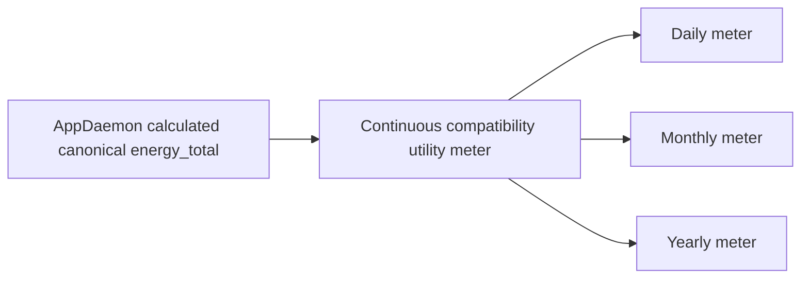

# WP0 — persistence, model, energy and future import

**Private persistence parity: BLOCKED B01/B02.** Public code and targeted live helper definitions were inspected; no private state/telemetry/Recorder database/export or production backup was copied. Sensor summaries do not prove durable on-disk bytes, complete historical coverage or a restorable backup.

## Assets and provenance

Paths below are public legacy filenames relative to configured `data_dir`, not an assertion that its live mount was read.

| Asset / owner | Format / version from pinned code | Contents and preservation contract | Evidence / availability |
|---|---|---|---|
| Local app YAML and AppDaemon app registration | YAML/JSON-compatible mapping; separate from HACS module directory | Actual bindings, startup allow_actuation, heartbeat lists, timezone, tariff, UI paths and external app dependencies | Public example exists; actual YAML/registration and hash BLOCKED B01. |
| `state.json` | JSON object, no single transactional top-level schema; validated collections/model; equipment_schema1, environment_version1 | Settings revisions/receipt, equipment history, permissions/ownership-related memory, once state, weather, observers, model/previous/pending candidate, learning dates, energy origin/bins, cycle and temperature evidence | `load_state` validates model bounds/types; corrupt input disables commands and preserves damaged file. `save` uses temporary write + os.replace; no explicit fsync/file+directory transaction. Actual bytes/hash unavailable. |
| Thermal champion/previous/candidate | Model version/validated plus coefficients floor_air, room_loss, floor_decay, heat_gain, fire_gain | Exact units, precision, version, daily baseline, parent model, train/holdout and prospective errors; rejected candidate must not remove valid champion | Metadata read from published sensors, values withheld. Persisted champion/candidate identity and replay parity BLOCKED B02. No coefficients trained, changed or inferred here. |
| `telemetry.jsonl` | JSONL; measurement_version3, environment_version1, equipment/model versions | Numeric inputs with timestamps/quality, exact room-reported age, source/method, grid, power, ventilation duty and model parameters used at the time | Adapter samples about290s; startup reads last4032 rows within14days. Daily learning rewrites its retained samples. Version-mismatched measurements are not silently admitted to training. Actual retained rows/hash unavailable. |
| `decision_history/YYYY-MM-DD.jsonl[.gz]` | Decision schema_version1; decision_id/plan/cycle/snapshot IDs | Command requested/sent/confirmation/response evidence, original issued plan and snapshot references; large overflow details retained separately | Daily JSONL and verified gzip compaction. Default14days, seven protected days, initial256MiB auto headroom up to1GiB. Exact retention overrides/content/volume require private manifest. |
| `decision_history/<sha256>.json.gz` | Sorted compact original JSON bytes, gzip mtime0, content SHA-256 | Immutable model/config/weather/plan input snapshots and original curves; read_snapshot verifies decompressed digest | `_snapshot`/`read_snapshot` verified in source. No actual household snapshot obtained; no synthetic retrospective curve substituted. |
| `memory.temperature_history`, cycle references and original issued plans | Stored in state and journal snapshots; plan/reference/model/source IDs | Original ≥12h forecast selected by latest eligible issue≤reference−12h; lead, coverage and missing evidence retained; actual continues without forecast | `select_temperature_forecast`, `observe_temperature_history`, `DecisionJournal.temperature_comparison`; legacy regressions exist. Actual frozen checksums remain BLOCKED. |
| `memory.inlet_energy` and `energy_bins` | origin_kwh + measured_kwh + estimated_kwh + recovered_kwh; unknown_seconds; last observation; month checkpoints | Canonical monotonic calculated total, method provenance and gaps. `measured` may mean derived measured components, never an independent boiler meter | Integrator and reconciliation reviewed; raw current totals and household time series omitted. B02/B03. |
| `memory.cycle_energy` | Dated UTC boundaries with local heating-cycle identity | Immutable initial and last-prestart references, latest estimate, known spend, counter delta, automatic/manual/transition attribution and incomplete coverage | `cycle_energy_allowance` subtracts known spend even when incomplete. No new source replaces initial reference after the cycle begins. Real parity needs B02. |
| Recovery artifacts / applied_recoveries | Legacy one-time `recovery-20261009.json`; newer recovery ID/hash/expected-total/bins; deployment_backups | Administrative correction idempotency and provenance, not training label or physical start timestamps | Legacy recovery code can create backups/rewrite data when invoked. **Not invoked**; actual artifacts/backup manifests unavailable and no new production backup authorized. |
| Native HA utility meters / Recorder statistics | Native helper definitions and persisted checkpoints/statistic IDs | Last valid state, last reset, origin, totals, historical reset periods and downstream consumers | Definitions read (H04); no reset/recreate, calibrate service or direct Recorder/storage editing. DB export and complete statistics continuity BLOCKED B02. |
| HACS/update/permissions state | Nine-module release manifest; input_text update journal; helper scene | Version integrity and in-flight permission restore; not a substitute for migration authority/consumed markers | Public manifest + current opaque receipts read. No update or lifecycle action. |
| Frontend generated files and HA resources | Digest-named JS, loader.js, version.json; local module resource | Presentation compatibility only; no separate source of command authority | `install_panel` writes these at application initialization. It was not run; existing resource metadata read only. |

## Verified counter chain

H04 read the five current native helper definitions, not just similarly named states:

The compatibility meter reads `sensor.heating_energy_total`, cycle none, periodically_resetting=true. Daily/monthly/yearly each read `sensor.kotel_spozhita_energiia`, have their named cycle and periodically_resetting=false. These are views of one calculated origin, not independent amounts to add together. Six sampled AppDaemon sensors have no returned registry entries while their states exist (H08); compatibility transfer must qualify supported ownership/statistics handling rather than deleting entities to reuse IDs.

Never switch a utility-meter source by resetting/recreating it. Future transfer first publishes the same canonical total, verifies zero first delta and preserved last_valid_state/reset/statistic IDs, then verifies subsequent deltas. A complete device/consumer manifest and private checkpoints remain missing.

## Confirmed methods and limitations

- Balance A subtracts three group meters and signed Deye GRID from inlet. Balance B uses non-overlapping appliance loads and GRID. Group members are not subtracted twice. Aliases are alternatives; both methods share sources and failure modes. Physical non-overlap and phase/direction proof remain B03.
- `integrate_observation` causally integrates the previous known power for at most45s; remaining gap contributes unknown_seconds. Repeated/retrograde timestamps do not add energy. Restart gaps are not backfilled with nominal3/6/9kW. `measured`, estimated and recovered contributions must remain distinct during import.
- Recovery validates evidence hash, expected total, past bounded intervals, overlap and already accounted energy; repeat ID/hash is idempotent. A reported daily total increase caused by a dated correction is not proof of physical consumption on its recording date. Correction energy must not become a training label.
- `energy_tick` keeps32-day bins and estimates fractional rolling24h overlap. Night/day values use the current-month-filtered bins despite “since start” labels. Cost uses the tariff read when the delta is recorded; intervals crossing a tariff/month boundary need explicit splitting in2.0. With no known bin costs old code can publish0 plus tariff_available=false: the new UI must retain unknown cost semantics. This is a source finding, not a claim that live tariffs are absent.
- Bounded Recorder sample H06 is useful for incident order but not a full private ledger or command-author log. No household values are republished. Long forecast readiness and short MAE do not establish24/36/48h accuracy or physical energy metrology.
- New required retention (raw≥30d, forecasts/comparisons≥90d, critical receipts≥30d) exceeds legacy defaults. Size and protected archives must be measured before selecting the proposed2GiB budget; never delete originals to meet a quota.

## Future read-only inspection / dry-run plan — not executed

1. Owner supplies an already available, privately controlled read-only export or narrowly authorized read channel for actual YAML, coherent state+JSONL+archive and native helper/statistic checkpoints. Preserve file sizes/mtimes/hashes, capture time, source commit/module hashes and redaction policy. No File editor startup or backup creation is authorized here.
2. Validate source schemas, units, finite numbers, hashes and archive references without initializing `HeatingClimate` or running migration/recovery routines. Record missing/truncated/orphaned data as exceptions. Freeze immutable originals in the owner's storage; public artifacts contain only sanitized statuses/hash references.
3. After a separate implementation instruction, inspect/import into a **new sandbox directory only**, assigning migration_id and source offsets. No directory, entity, HA database or legacy file overwrite. Keep original curves, issue/lead times and nullable quality exactly; no replay to manufacture absent evidence.
4. Verify critical settings/manual pause/one-shot kind and consumed/unknown outcome; champion/previous/candidate and daily learning markers; coefficients/units/model versions; canonical and period totals within1e-6kWh; exact frozen curve hashes; bins/gap categories/cycle scopes and native reset checkpoints. Origin plus ledger categories must reconcile.
5. Run the importer again: identical source gives no new ledger/intent/counter side effect. Test duplicate corrections, method switch, source reset/jump, DST/month/year, corrupt snapshot and unknown periods. Defer unsupported mappings explicitly; do not mark parity pass with exceptions hidden.
6. Rehearse forward import plus rollback of **new deltas** and consumed one-shots on the isolated stand. A whole old backup restore must not erase newly observed energy/settings. G2/G4/G7 require their own evidence/approval; none was performed during WP0.
